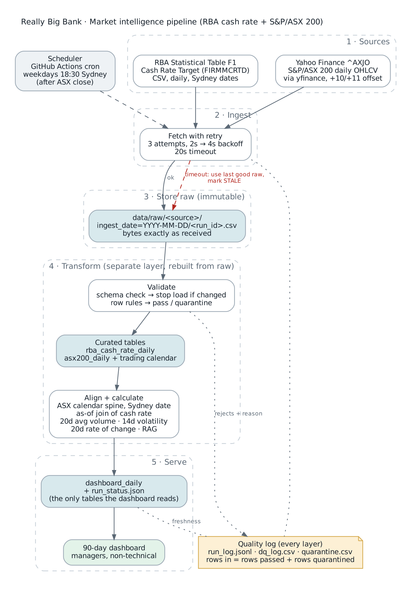

# RBA cash rate + S&P/ASX 200: market intelligence proof of concept

**Really Big Bank · post-trade analytics · BUSA3022 Analytics Implementation Plan**

Business question: *How are markets trending, so bank performance can eventually be benchmarked against industry data?*
This repository is the working thin slice behind the implementation plan. It covers 2 sources, 3 metrics, 1 dashboard.

| | Source | Series | Why |
|---|---|---|---|
| Macro | RBA Statistical Table F1 (daily CSV) | Cash Rate Target `FIRMMCRTD` | Australia's policy rate, which drives funding costs and asset prices |
| Market | Yahoo Finance via `yfinance` | S&P/ASX 200 `^AXJO` daily OHLCV | The benchmark index for Australian equities |




**Model choice and the prompts used at each step:** [docs/PROMPTS.md](docs/PROMPTS.md)

## Run it

**Google Colab (recommended).** Open `notebooks/RBA_ASX200_PoC.ipynb`, set your GitHub username in the first
code cell, then *Run all*. It runs the tests and the live pipeline, checks one metric by hand, runs both failure
demos and builds the dashboard.

**Locally**
```bash
pip install -r requirements.txt
PYTHONPATH=src pytest -q                                              # 18 tests
PYTHONPATH=src python -m rbabank.pipeline --dashboard                 # live data
PYTHONPATH=src python -m rbabank.pipeline --offline --dashboard       # sample data, no internet
PYTHONPATH=src python -m rbabank.pipeline --offline --simulate timeout
PYTHONPATH=src python -m rbabank.pipeline --offline --simulate schema_change
```

**On a schedule.** `.github/workflows/daily-load.yml` runs every weekday at 07:30 UTC (after the ASX close). It
runs the tests first, loads both sources, rebuilds the dashboard, and fails loudly if any source is stale.

## Pipeline layers

| # | Layer | Code | Output | Rule |
|---|---|---|---|---|
| 1 | Ingest | `ingest.py` | | Same fetch every run. 3 attempts, 2 s → 4 s backoff, 20 s timeout |
| 2 | Raw store | `ingest.land_raw` | `data/raw/<source>/ingest_date=…/<run_id>.csv` | Bytes exactly as received. Never edited |
| 3 | Validate | `validate.py` | `data/curated/*.csv` | Schema check stops the load. Row rules pass or quarantine each row |
| 4 | Transform | `transform.py` | `data/serve/dashboard_daily.csv` | Align on the Sydney trading date, calculate metrics and RAG |
| 5 | Serve | `dashboard.py` | `docs/dashboard.html` | Reads only the serve layer |
| ⟂ | Quality log | `quality.py` | `data/quality/` | `run_log.jsonl`, `dq_log.csv`, `quarantine.csv`. Rows in = passed + quarantined (asserted) |

Storage is kept separate from transformation. Raw files are immutable, and curated and serve tables can be rebuilt
from raw at any time.

## Failure handling

| Scenario | Detection | Response | Logged |
|---|---|---|---|
| API timeout / HTTP error | Exception from the fetch | Retry ×3 with backoff. Then use the last good raw file, mark the source **STALE** in `run_status.json` and on the dashboard, and fail the scheduled job so someone is emailed | Every attempt, error, fallback file |
| Schema change | Expected series ID / columns missing | Stop that source's load (no guessing), quarantine the file, leave curated data untouched, mark stale | Expected vs received fields |
| Bad rows | Row rules (below) | Quarantine with a reason. Never dropped | Count per rule per run |

Row rules: invalid date · non-numeric or missing cash rate · cash rate outside 0–20% · day-on-day rate jump > 1 pp ·
missing close / OHLC · high < low or close outside the range · duplicate trading date · daily index move > 15%.
Repairs that keep the row: zero or missing index volume is set to blank (not zero) and flagged.

## Metrics and signal

Plain-language definitions, written before the code, are in **[docs/METRICS.md](docs/METRICS.md)**.

- **M1** 20-day average volume (needs 15 of 20 valid days)
- **M2** 14-day realised volatility, annualised: sd of daily log returns × √252 (needs 12 of 14)
- **M3** 20-day rate of change of the close
- **How the 3 series relate** (index, cash rate, volatility): correlation of index trend vs volatility; index and volatility in the 10 days around each rate change
- **RAG** on M2 vs the prior 252 trading days: GREEN < p75 ≤ AMBER < p90 ≤ RED; 5 amber days in a row → RED; < 120 days of history → GREY

## Time zones and calendar

- Common axis: **ASX trading date in `Australia/Sydney`**. The ASX calendar is the spine.
- Yahoo timestamps arrive as Sydney midnight with an offset (`+10:00` or `+11:00` depending on daylight saving). They
  are converted to Sydney *before* taking the date, because taking the date in UTC shifts every day back by one.
- The RBA cash rate is attached with an as-of (backward) join. It never looks forward. On days with no RBA row
  (e.g. the NSW Bank Holiday) the previous value is carried forward and flagged.
- Quarantined trading days stay on the calendar as blank rows, so no return is calculated across a missing day.

## Repository map

```
src/rbabank/   config · ingest · validate · transform · quality · pipeline · dashboard · static_chart
tests/         test_pipeline.py (18 tests) · make_fixtures.py · fixtures/ (illustrative sample files)
notebooks/     RBA_ASX200_PoC.ipynb (Colab)
docs/          workflow.png · PROMPTS.md · architecture.png · METRICS.md · STANDARDS.md (handoff + AI guardrails) · AI_LOG.md
               dashboard_sample.html · dashboard_static_sample.png (illustrative data)
.github/       daily-load.yml (schedule) · tests.yml (every pull request)
```

## Handoff

See **[docs/STANDARDS.md](docs/STANDARDS.md)** for the junior-analyst runbook, layer rules, modelling standards,
what to do when something fails, and the guardrails for AI-generated code. **[docs/AI_LOG.md](docs/AI_LOG.md)**
records the real mistakes the AI agent made during development and how each one was caught.

## Notes and limits

- The sample files in `tests/fixtures/` copy the real file layouts but contain **simulated numbers**, with planted
  errors for testing. Anything labelled "sample" or "illustrative" is not real market data.
- Yahoo Finance is an unofficial source and can rate-limit or change its format. A production build would use a
  licensed feed. The schema check and the stale flag are what make that risk visible.
- AI use: code in this repository was developed with Claude (Anthropic) under the guardrails in `docs/STANDARDS.md`.
