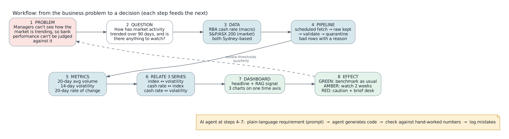

# Prompt log and model choice

This file shows **which models were chosen and why**, and **the prompts used at each step of the workflow**.
Each prompt was written in plain language *before* any code, given to the AI agent, and the output was checked
against numbers worked out by hand. The steps follow the workflow in `docs/workflow.png`. Each step's output is
the next step's input.

---

## Part A: Why these models

### A1. Analytics model: descriptive monitoring, not prediction

| Option (Week 3 spectrum) | Fits the question? | Decision |
|---|---|---|
| **Descriptive**: what happened over 90 days | Yes. The question asks "how has activity *trended*" | **Chosen** |
| **Rule-based signal on descriptive metrics** (RAG): is anything unusual? | Yes. "Is there anything we should be *watching*" | **Chosen** |
| Predictive: forecast the index or the rate | No. Nobody asked for a forecast, and a forecast would overstate certainty to a non-technical audience | Not used |
| Prescriptive: recommend trades | No. Out of scope for a benchmarking team | Not used |

The answer stays explainable: every number on the dashboard can be recalculated by hand from the data.

### A2. Data model: one row per ASX trading day

- **Grain.** One row = one ASX trading day, dated in Sydney time. Both sources are joined onto this grain.
- **Why.** Market data only exists on trading days, and the cash rate is a step series (it changes about 8 times
  a year at most), so the cash rate is attached to each trading day rather than the other way around.

### A3. AI model: Claude (Anthropic), used as a coding agent

| Need | Why an AI agent helps | Guardrail |
|---|---|---|
| Write a working pipeline in hours, not days | Generates pipeline, test and chart code from a written requirement | Every requirement is written by the lead first (prompts below) |
| Code must match the lecture frameworks | The agent was given the brief and the lecture slides as context | The output is reviewed against the rubric |
| Code must be correct | The agent can run the tests it writes | Expected test values are calculated by hand, not by the agent |

Reference: Anthropic. (2026). *Claude* (Opus 5.5) [Large language model]. https://claude.ai

---

## Part B: The prompts, step by step

### Step 1: Problem and scope (the opening request)

> Here are the case-study brief and my 12 weeks of lecture notes. I am the analytics lead at Really Big Bank.
> Management wants to understand how markets are trending so bank performance can later be benchmarked against
> industry data. Use the **RBA cash rate** as the macro series and the **S&P/ASX 200 from Yahoo Finance** as the
> market series. Keep the scope to 2 sources, 2–3 metrics and one dashboard. The code will run in Google Colab
> and be stored in GitHub.

**Why written this way:** it states the role, the business question, the two sources and the limits, so the
agent does not invent extra scope.

### Step 3–4: Data and pipeline

> Build a Python pipeline with these layers, each in its own module:
> 1. **Ingest:** download RBA Statistical Table F1 (CSV) and ^AXJO daily prices from Yahoo Finance the same way on
>    every run. Use a 20-second timeout and up to 3 attempts, waiting 2 then 4 seconds.
> 2. **Raw:** save each download byte-for-byte, in a folder named by source and date, with a run ID. Never edit
>    these files.
> 3. **Validate:** first check the file still has the fields we expect (series ID FIRMMCRTD; columns Date, Open,
>    High, Low, Close, Volume). If not, stop that source's load. Do not guess. Then check every row: valid date,
>    numeric values, high ≥ low, close between low and high, no duplicate dates. A row that fails goes to a
>    quarantine file with the rule it failed. **No row may be dropped without being logged.**
> 4. **Failure:** if every download attempt fails, use the last good raw file, mark the source STALE, and log every
>    attempt.
> Write a data-quality log showing, per rule per run, rows in, rows passed and rows quarantined.

**Checked by:** running the pipeline on sample files with planted errors (a blank close, high below low, a
duplicate day, a non-numeric rate) and confirming each one appears in quarantine with the right reason, and that
rows in = rows passed + rows quarantined.

**What went wrong:** the agent put the download *and* the file-saving inside one error handler, so a disk error
would have been reported as "website down". Caught in testing and fixed (AI_LOG.md, example 1).

### Step 5: Metrics (the requirement written before any code)

> Calculate three metrics. One row is one ASX trading day in Sydney time. Windows count trading days, not
> calendar days. A blank value is never treated as zero.
> - **20-day average volume:** the average daily volume over the last 20 trading days including today. Needs at
>   least 15 valid days, otherwise blank. If Yahoo shows zero volume, treat it as missing and flag the row.
> - **14-day volatility:** daily return = natural log of (today's close ÷ previous trading day's close). Take the
>   sample standard deviation of the last 14 returns, multiply by √252 and express as a %. Needs 12 valid
>   returns. Never calculate a return across a missing day.
> - **20-day rate of change:** (today's close ÷ close 20 trading days ago − 1) × 100.
> Attach the cash rate to each trading day using the latest RBA value dated on or before that day. Never use a
> future value. If the RBA has no row that day, carry the last value forward and flag it.
> Convert Yahoo timestamps to Sydney time **before** taking the date.

**Checked by:** tests with answers worked out by hand. For example, closes 100, 101, 99, 102 give a known
volatility. The notebook also recalculates today's volatility step by step on live data, and it matches the
pipeline exactly.

### Step 6: How the three time series relate

> Using the three series ASX 200 close, cash rate target and 14-day volatility, show how they move together. Keep
> it descriptive, with no causal claims:
> 1. Index ↔ volatility: the correlation between 20-day rate of change and 14-day volatility over the last 90 days,
>    with the strength in words (weak < 0.3, moderate < 0.6, strong).
> 2. Cash rate ↔ index: for each change in the cash rate, the index move over the 10 trading days from the day
>    before the change.
> 3. Cash rate ↔ volatility: the average volatility in the 10 trading days after each change compared with the 10
>    days before.

**Checked by:** a test with a made-up series where the answer is obvious (the index steps from 100 to 110 after
the change → +10.0%, volatility 10 → 20).

**What went wrong:** the first version calculated "index move after a rate change" in two different ways in two
places, so one event showed +2.9% in one panel and +1.0% in another. Fixed by using one shared calculation.

### Step 7: Dashboard (prompt iteration for the audience)

**First prompt**

> Build a dashboard showing the ASX 200 over 90 days with a rolling average, the cash rate, and a RAG signal.

**Problem with the output:** correct, but written for analysts. It had no takeaway, and its headline said the
index rose "*after*" the rate rise, which a non-technical reader takes to mean "*because of*".

**Second prompt (iterated)**

> The readers are managers who know finance but not code. Start with **one sentence that states the takeaway**.
> Put the RAG state next to a word and an action, not colour alone. Use three charts that share one time axis:
> index with cash rate, volume with its 20-day average, and volatility with the amber and red zones shaded. State
> what each series did side by side. **Do not imply that the rate change caused the index move.** Show data
> freshness and the number of quarantined rows in a small "data health" section, so readers can trust the numbers.

**RAG requirement**

> Compare today's 14-day volatility with the previous 252 trading days (not including today). GREEN below the 75th
> percentile; AMBER from the 75th to below the 90th; RED at or above the 90th, or AMBER 5 trading days in a row;
> GREY if there are fewer than 120 days of history. For each state, tell the reader what to do.

**Checked by:** a test with a history of 1 to 10, where the 75th and 90th percentiles are 7.75 and 9.1 by hand.

### Step 8: Effect on the problem

| Dashboard says | What the bank does | Effect on the benchmarking problem |
|---|---|---|
| GREEN | Compare bank performance with the market as usual | Benchmark is reliable |
| AMBER | Watch the next two weeks before drawing conclusions | Avoids reacting to short-term noise |
| RED | Treat short-term comparisons with caution; brief the desk | Stops a volatile month being read as bank under- or over-performance |

---

> **Student note:** add any prompt you change yourself while running the notebook on live data, with what went
> wrong and how you noticed. Your own example counts for more than these.
